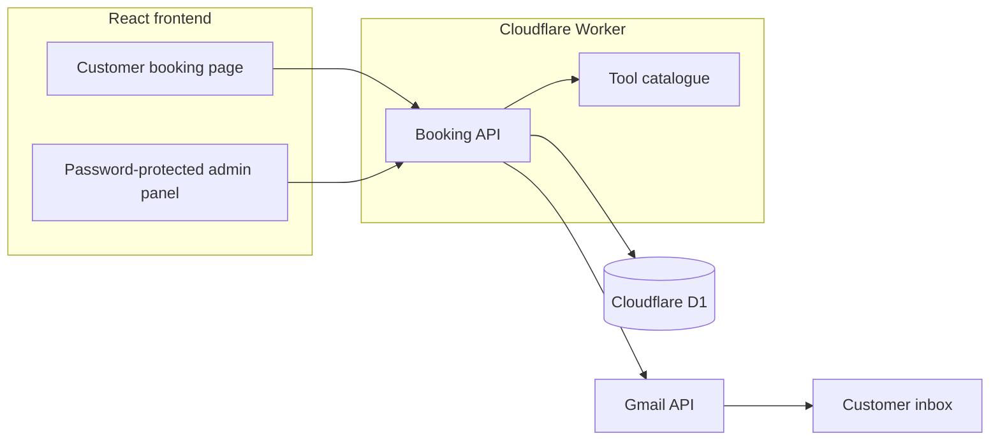
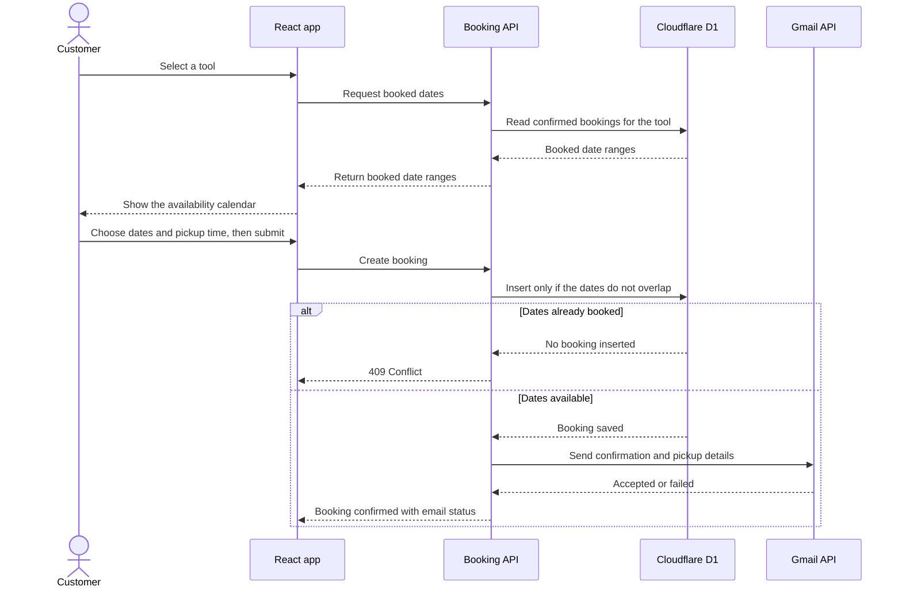

# HiHire

**Hiring tools is as easy as saying hi.**

HiHire is a tool hire booking app for customers in Auckland, New Zealand. Customers can check availability, reserve a tool by the day, and receive their pickup details by email. The operator uses a password-protected admin panel to manage bookings from the website and other channels.

[Open HiHire](https://hihire.hihire.workers.dev/)

## Rental catalogue

| Tool | Daily rate | Deposit |
| --- | ---: | ---: |
| Wood Chipper | NZ$20 | NZ$200 |
| Steam Upholstery Cleaner | NZ$30 | NZ$200 |

Both the start and end dates count towards the rental. Choose the same date for both fields to hire for one day. The app displays the hire charge and deposit when calculating the total.

## How the app is organised

| Area | What you can do |
| --- | --- |
| Customer booking page | Choose a tool, see booked dates in the calendar, select rental dates and a pickup time, and submit your contact details. |
| Admin panel | Sign in, view and refresh bookings, add bookings received outside the website, and cancel bookings. The list adapts to desktop and mobile. |

### System architecture



In production, one Cloudflare Worker serves the built React app and routes API requests to a shared Node.js HTTP handler. Cloudflare D1 stores booking records. Gmail API sends online booking confirmations and pickup details. For local Node.js development, the same booking handler uses SQLite for storage and SMTP for email.

### Online booking flow



The API checks for overlapping reservations when it writes the booking, so two customers cannot reserve the same tool for the same dates. An email failure leaves the booking saved. Manual bookings can omit the phone number and email address, and they do not send an automatic confirmation. Cancelling a booking releases its dates while keeping the record visible in the admin panel.

## Project structure

```text
HiHire/
├── client/                           # React frontend built with Vite and Tailwind CSS
│   └── src/
│       ├── App.jsx                   # Customer booking page and admin entry point
│       └── components/
│           ├── AdminPanel.jsx        # View, add, and cancel bookings
│           └── BookingCalendar.jsx   # Rental date selection and availability
├── data/
│   └── products.js                   # Tool catalogue, daily rates, and deposits
├── services/
│   ├── booking-api.js                # Shared API routes, validation, and pricing
│   ├── booking-confirmation.js       # Shared confirmation email content
│   └── email.js                      # SMTP sender for the local Node.js server
├── worker/
│   ├── index.js                      # Cloudflare Worker entry point
│   ├── bookings.js                   # Cloudflare D1 booking storage
│   └── gmail.js                      # Production email via the Gmail API
├── database/
│   ├── bookings.js                   # SQLite booking storage for local Node.js
│   └── migrations/
│       └── 0001_bookings.sql         # D1 booking schema
├── server.js                         # Local Node.js server
├── wrangler.jsonc                    # Worker, static assets, and D1 configuration
└── DEPLOY-CLOUDFLARE.md              # Deployment and Gmail setup
```

## Run locally

Use Node.js 24 and npm. From the repository root, install dependencies, build the frontend, and apply the database schema to the local D1 instance.

```bash
npm ci
npm --prefix client ci
npm --prefix client run build
npx wrangler d1 migrations apply hihire-bookings --local
```

Create a `.dev.vars` file in the repository root with test values.

```dotenv
ADMIN_API_KEY="YOUR_LOCAL_TEST_PASSWORD"
PICKUP_ADDRESS="Test pickup address"
```

Run the Worker and open the local URL printed by Wrangler.

```bash
npx wrangler dev
```

You can create bookings without Gmail credentials in local development. The app will report that the confirmation email could not be sent. Keep local credentials and booking exports out of Git.

## Deploy to Cloudflare

Cloudflare Workers Builds watches the GitHub `main` branch. It installs the frontend dependencies and builds the React app before deploying the Worker and its static assets.

| Workers Builds setting | Value |
| --- | --- |
| Production branch | `main` |
| Root directory | `/` |
| Build command | `npm --prefix client ci && npm --prefix client run build` |
| Deploy command | `npx wrangler deploy` |

The [Cloudflare deployment guide](DEPLOY-CLOUDFLARE.md) covers D1 setup, Gmail OAuth, Worker secrets, and manual deployment.
